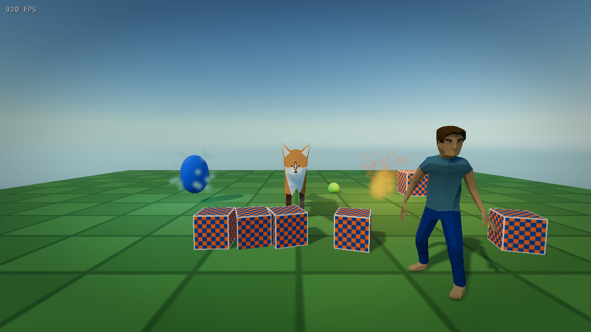

<div align="center">

# EGN Engine

**Engine de jogos multiplataforma escrita em C.**

Renderizador Vulkan no Linux e WebGPU no navegador, física Jolt, animação
esquelética, partículas na GPU e jogos escritos em **V**.


</div>

<p align="center">
  
</p>

<p align="center">
  <em>Demo oficial rodando no Linux com Vulkan: PBR, sombras em cascata, atmosfera,
  animação esquelética, física e partículas na GPU.</em>
</p>

## Sobre

A **EGN** é uma engine de jogos multiplataforma escrita em C, com foco em
desempenho e em uma API pequena para o jogo. O núcleo é compilado como uma
biblioteca (`libengine.so` no Linux, WebAssembly no navegador) e não impõe um
loop interno: o jogo é dono do próprio loop e chama `app.frame()` enquanto
`app.should_run()` for verdadeiro.

A engine cuida de janela, inputs, eventos, cena, física, animação, partículas,
rede e renderização. Os jogos são escritos em **V** através do módulo
[`egn/`](egn/README.md), a única ponte entre o jogo e a engine — o jogo não
inclui headers C nem conhece Wayland, Vulkan ou WebGPU.

> **Próximos passos:** uma linguagem de script para os componentes — com toda a
> biblioteca necessária fornecida pela engine — e um editor visual para montar
> cenas, inspecionar componentes e editar comportamentos.

## Recursos

| Área | O que já está disponível |
| --- | --- |
| **Renderização** | Vulkan 1.3 no Linux e WebGPU no navegador; PBR metallic-roughness com mapas de base color, metallic-roughness, normal, oclusão e emissivo; HDR com tone mapping Reinhard/ACES/AgX; shadow mapping CSM com até 4 cascatas; atmospheric scattering; SSAO + SSGI; bloom; auto exposure por histograma; color grading e LUT 3D `.cube` |
| **Cena** | Hierarquia de objetos, transforms acumulados, quaternions + helpers Euler, layers, múltiplas câmeras com viewport/clear independentes, `Camera2D` e `Canvas` para UI e jogos 2D |
| **Componentes** | `Camera`, `Model`, `Sprite`, `Animation`, `Light`, `Rigidbody`, `Collider`, `CharacterController`, `CharacterController2D` e `Particles` |
| **Assets** | OBJ multi-material, glTF/GLB com skeleton e skinning GPU, texturas, fontes TrueType e LUTs `.cube` |
| **Física** | Jolt Physics via JoltC: corpos 2D/3D, colisores box, esfera, cápsula e malha (inclusive malha dinâmica), character controller e timestep fixo |
| **Partículas** | Simulação em compute shader na GPU e renderização de billboards com textura, cor/tamanho ao longo da vida, gravidade e drag |
| **Rede** | TCP e UDP não bloqueantes, servidores, clientes e host (servidor + cliente local), fila de eventos e mensagens com framing por tamanho |
| **Plataformas** | Linux/Wayland (Vulkan) e Web/WASM (WebGPU); modo **headless** para servidores, sem janela ou GPU |
| **Ferramentas** | SDK V `egn`, presets gráficos aplicáveis em runtime, contador de FPS, screenshots e testes automatizados em C |

### Plataformas

| Plataforma | Backend gráfico | Status |
| --- | --- | --- |
| Linux (Wayland) | Vulkan 1.3 | ✅ Suportado |
| Web (WebAssembly) | WebGPU + WGSL | ✅ Suportado |
| Headless (servidor) | — | ✅ Sem janela/renderer |
| Windows | — | 🚧 Planejado |
| macOS | — | 🚧 Planejado |

A camada de plataforma fica isolada em `engine/platform/<os>` e em
`engine/renderer/<backend>`; adicionar um novo sistema operacional não exige
alterar o jogo nem o SDK.

## Começando

### 1. Pré-requisitos

Linux (Ubuntu/Debian):

```sh
sudo apt install clang g++ make cmake git curl \
  libwayland-dev libvulkan-dev glslc
```

Opcional, para habilitar a camada de validação do Vulkan em desenvolvimento:

```sh
sudo apt install vulkan-validationlayers
```

O compilador V (0.5+) é necessário para compilar o jogo. O Makefile usa
`third_part/v/v` quando existir, ou o `v` do `PATH`.

### 2. Monte a pasta `third_part/`

A pasta `third_part/` **não é versionada**. Ela reúne as dependências baixadas
localmente. O comando abaixo baixa as bibliotecas single-header, compila o
JoltC/Jolt e o compilador V:

```sh
make deps
```

Se preferir montar manualmente, todos os links e destinos estão na seção
[Montando a pasta `third_part`](#montando-a-pasta-third_part).

### 3. Compile e execute

```sh
make run
```

Ou, separadamente:

```sh
make engine   # libengine.so + shaders SPIR-V
make game     # jogo V (requer a engine compilada)
make          # equivale a make all
```

| Comando | O que faz |
| --- | --- |
| `make` / `make all` | Compila engine + jogo |
| `make engine` | Somente a engine (`output/linux/libengine.so` + shaders) |
| `make game` | Somente o jogo (a engine precisa existir) |
| `make run` | Compila tudo e executa o jogo |
| `make test` | Compila e roda a suíte de testes |
| `make clean` | Remove `build/` e `output/` |
| `make deps` | Baixa headers e compila Jolt + V em `third_part/` |
| `make v` | Clona/compila apenas o compilador V |
| `make jolt` | Clona/compila apenas JoltC + Jolt |
| `make help` | Lista alvos e variáveis |

Variáveis úteis:

```sh
make PLATFORM=linux    # força a plataforma
make CC=clang          # força o compilador C
make V=/caminho/para/v # força o compilador V
make OPT=-O0           # build de depuração (padrão: -O2)
```

Os assets de `game/assets/` são copiados para `output/linux/assets/`, e os
shaders GLSL de `engine/shaders/` são compilados para SPIR-V em
`output/linux/shaders/`.

## Estrutura do projeto

```text
engine/       Núcleo da engine em C
  core/       Engine, janela, inputs, eventos, log e memória
  renderer/   Backends Vulkan/WebGPU, shaders e configurações gráficas
  scene/      Cena, objetos, componentes e animação
  physics/    Integração com Jolt Physics
  network/    TCP e UDP
  platform/   Camada de plataforma (linux, web)
egn/          SDK em V — única interface entre o jogo e a engine
game/         Jogo de demonstração (main.v) e assets
tests/        Testes C e teste de animação GLB no Node
web/          Página e host do demo WebAssembly
docs/         Imagens usadas na documentação
third_part/   Dependências locais (não versionado)
output/       Artefatos de build (não versionado)
```

O jogo é dono do loop e a cena é renderizada automaticamente a cada `frame()`,
percorrendo as câmeras e os componentes ativos. A engine não contém lógica do
jogo nem um `main` próprio.

## Exemplo mínimo

```v
module main

import egn { Settings, create }

fn main() {
    mut app := create(Settings{
        title:  'Meu jogo'
        width:  960
        height: 540
    })!
    defer {
        app.destroy()
    }

    for app.should_run() {
        app.frame()
    }
}
```

Para compilar um jogo que esteja dentro do repositório:

```sh
v -path '/caminho/para/game_engine|@vlib|@vmodules' -o output/linux/meu_jogo meu_jogo/
```

O `game/v.mod` define o projeto V. O Makefile passa automaticamente
`-path '<raiz do repositório>|@vlib|@vmodules'` para que `import egn` encontre
a pasta `egn/` e a biblioteca padrão continue disponível.

## Cena, objetos e componentes

A cena é o objeto raiz (id 1). `app.scene()` devolve esse objeto; todos os
outros objetos são criados como filhos. As transformações dos pais são
acumuladas nos filhos (posição, rotação e escala), como na Unity.

Cada objeto tem `position`, `rotation` (quaternion), `scale`, `layer` (0..31),
`active`, pai/filhos e componentes.

```v
module main

import egn {
    Camera
    Model
    Settings
    Viewport
    create
    rgb
    vec3
}

fn main() {
    mut app := create(Settings{ title: 'Cena', width: 1100, height: 620 })!
    defer {
        app.destroy()
    }

    scene := app.scene()

    // Um pivô com um filho: o filho herda a transformação do pai.
    pivot := scene.create_object('Pivot')
    pivot.set_position(vec3(1, 0, 0))

    cube := pivot.create_child_euler_deg('Cube', vec3(2, 0, 0), vec3(0, 45, 0), vec3(1, 1, 1))
    cube.set_layer(u32(1))
    cube.add_component(Model{
        mesh:  app.mesh_cube()
        color: rgb(1.0, 0.42, 0.12)
    })

    // Duas câmeras na mesma layer, cada uma em meia tela (split-screen).
    left := scene.create_object('Left Camera')
    left.set_position(vec3(-2.2, 1.6, 5))
    left.look_at(vec3(0, 0, 0))
    left.add_component(Camera{
        viewport:   Viewport{ x: 0.0, y: 0.0, width: 0.5, height: 1.0 }
        layer_mask: u32(1 << 1)
        clear_color: rgb(0.02, 0.04, 0.12)
    })

    right := scene.create_object('Right Camera')
    right.set_position(vec3(2.2, 1.6, 5))
    right.look_at(vec3(0, 0, 0))
    right.add_component(Camera{
        viewport:   Viewport{ x: 0.5, y: 0.0, width: 0.5, height: 1.0 }
        layer_mask: u32(1 << 1)
        clear_color: rgb(0.08, 0.02, 0.10)
    })

    for app.should_run() {
        cube.rotate_euler_deg(vec3(0, 1, 0))
        app.frame()
    }
}
```

### Componentes principais

| Componente | Descrição |
| --- | --- |
| `Camera` / `Camera2D` | Câmera perspectiva ou ortográfica, viewport normalizada, layer mask, clear e ordem de renderização |
| `Model` | Mesh 3D com cor/textura, PBR, sombras e superfícies procedurais (`standard`, `terrain`, `ocean`) |
| `Sprite` | Quad texturizado em unidades de mundo (plano XY) ou em canvas |
| `Animation` | Toca um clip de um GLB com skinning na mesma malha do `Model` |
| `Light` | Luz direcional (sol) ou pontual, com cor, intensidade, alcance e sombras |
| `Rigidbody` + `Collider` | Corpo estático, cinemático ou dinâmico com colisor box, sphere, capsule ou mesh |
| `CharacterController` | Controlador de personagem com velocidade, pulo e detecção de chão |
| `Particles` | Emissor de partículas simulado na GPU |
| `Canvas` | Objetos ancorados na tela, independentes da câmera 3D |

#### Camera

| Campo | Descrição |
| --- | --- |
| `projection` | `.perspective` ou `.orthographic` |
| `fov` | FOV vertical em graus (perspectiva) |
| `ortho_size` | Altura visível em unidades de mundo (ortográfica) |
| `near`, `far` | Planos de recorte |
| `viewport` | `Viewport{ x, y, width, height }` normalizado (0..1) |
| `layer_mask` | Bitmask dos layers renderizados |
| `clear_color` | Cor de fundo da viewport |
| `clear_color_enabled` | Limpa a cor da viewport |
| `clear_depth_enabled` | Limpa o depth da viewport |
| `order` | Ordem de renderização entre câmeras |
| `enabled` | Ativa/desativa a câmera |

A câmera usa a transformação do objeto dono (posição + rotação), então
`object.look_at(target)` orienta a câmera. O aspect ratio é calculado pela área
da viewport.

#### Model e Sprite

```v
obj.add_component(Model{
    mesh:    app.mesh_cube()
    texture: checker // opcional; vazio = branco
    color:   rgb(1.0, 0.42, 0.12)
    metallic: 0.0
    roughness: 0.8
    surface: .standard // .terrain ou .ocean para shading procedural
})

ui.add_component(Sprite{
    texture: checker
    size:    vec2(1.0, 1.0)
    pivot:   vec2(0.5, 0.5)
    color:   rgb(1, 1, 1)
})
```

#### Acessando componentes

`add_component` devolve um handle; `get_component[T]()` busca o primeiro
componente do tipo no objeto:

```v
mut cam := camera_object.get_component[Camera]() or {
    panic('camera component not found')
}
cam.set_fov(50)
cam.set_layer_mask(u32((1 << 1) | (1 << 2)))
```

Os métodos `set_*` atualizam a engine imediatamente. Ao alterar campos
diretamente, chame `apply()` para sincronizar:

```v
cam.fov = 50
cam.apply()
```

`component.enabled` e `object.set_active(false)` desativam o componente/objeto;
desativar um objeto também desativa seus filhos.

## Rotação (quaternion + Euler)

A rotação é armazenada como quaternion. Para conveniência há helpers Euler:

```v
obj.set_euler(vec3(0, 1.0, 0))       // radianos
obj.set_euler_deg(vec3(0, 45, 0))    // graus
obj.rotate_euler(vec3(0, 0.1, 0))    // delta local, radianos
obj.rotate_euler_deg(vec3(0, 5, 0))  // delta local, graus
obj.set_rotation_quat(quat_from_euler_deg(vec3(0, 45, 0)))
```

## API do SDK (resumo)

| Área | API |
| --- | --- |
| Ciclo de vida | `egn.create(Settings) !Engine`, `frame()`, `should_run()`, `quit()`, `destroy()` |
| Tempo | `delta_time()`, `elapsed_time()` |
| Janela | `window_size()`, `set_vsync()`, `set_target_fps()`, `is_headless()` |
| Cena | `scene()`, `Object.create_object()`, `create_child()`, `create_child_euler_deg()` |
| Objetos | `set_position`, `position`, `set_rotation_quat`, `rotation`, `set_euler(_deg)`, `rotate_euler(_deg)`, `look_at`, `set_scale`, `scale`, `set_layer`, `layer`, `set_active`, `active`, `set_parent`, `parent`, `child_count`, `child_at`, `destroy` |
| Componentes | `add_component(Camera/Model/Sprite/...)`, `get_component[T]()`, `set_enabled`, `apply`, `destroy` |
| Câmera | `set_projection`, `set_fov`, `set_ortho_size`, `set_clip_planes`, `set_viewport`, `set_layer_mask`, `set_clear_color`, `set_order` |
| Model/Sprite | `set_mesh`, `set_texture`, `set_color`, `set_size`, `set_pivot`, `set_pbr`, `set_surface` |
| Recursos | `load_texture`, `load_obj`, `load_glb`, `load_lut`, `load_text`, `mesh_cube`, `mesh_sphere`, `screenshot` |
| Canvas/UI | `set_render_domain`, `set_canvas_anchor`, `canvas_pick`, `canvas_hovered`, `canvas_clicked` |
| Teclado | `key_down(Key)`, `key_up`, `key_pressed`, `key_released` |
| Mouse | `mouse_down(MouseButton)`, `mouse_up`, `mouse_pressed`, `mouse_released`, `mouse_position()`, `mouse_previous_position()`, `mouse_wheel()`, `mouse_previous_wheel()`, `mouse_delta()` |
| Eventos | `on_event(EventCode, callback)`, `off_event`, `fire_event` |
| Log | `egn.log_info`, `log_warn`, `log_error`, `log_debug`, `log_trace`, `log_fatal` |
| Math | `Vec2`, `Vec3`, `Vec4`, `Quat`, `Rect`, `Viewport`, `Color` |

Detalhes para adicionar novas funções da engine ao módulo estão em
[`egn/README.md`](egn/README.md).

## Jogo de demonstração

O jogo em [`game/main.v`](game/main.v) demonstra a engine completa:

- chão texturizado com colisão estática;
- Fox do Khronos com skeleton e animação `Walk`;
- humanoide de Quaternius com animação esquelética `Idle` em loop;
- caixas, esfera, corpo 2D e um OBJ com colisor de malha dinâmico;
- sol com sombras, luzes pontuais, fogo e cristal com partículas na GPU;
- câmera FPS com pointer lock real no Wayland;
- contador de FPS renderizado pela engine, com VSync desativado por padrão.

### Controles

| Tecla | Ação |
| --- | --- |
| `WASD` | W/S na direção da câmera, A/D strafe |
| `Space` | pular |
| `Shift` | correr |
| mouse | olhar (clique captura o ponteiro) |
| botão esquerdo | pegar / soltar corpo dinâmico |
| botão direito | arremessar corpo segurado |
| `Esc` | encerra o jogo |
| `F1` | alterna VSync |
| `F2` | alterna limite de FPS (off/60/120/144) |
| `F3` | cicla preset gráfico (low/medium/high/ultra) |
| `F4`..`F11` | liga/desliga HDR, sombras, AO, GI, atmosfera, bloom, auto exposure e color grading |
| `L` | liga/desliga o LUT de exemplo |
| `F12` | salva `screenshot.png` |

## Configuração gráfica

O renderizador Vulkan e o WebGPU usam a mesma estrutura de configuração e os
mesmos presets. Cada recurso tem um interruptor e uma qualidade independente:

- **HDR** em alvo `RGBA16F`, tone mapping Reinhard/ACES/AgX, exposição manual e
  auto exposure por histograma;
- **Color grading** com contraste, saturação, temperatura/tint, lift/gamma/gain,
  vinheta e LUT 3D `.cube` opcional;
- **Shadow mapping CSM** com até 4 cascatas, PCF e bias por cascata;
- **PBR** metallic-roughness com mapas de base color, metallic-roughness,
  normal, oclusão e emissive (glTF + `map_bump` do OBJ);
- **Atmospheric scattering** Rayleigh/Mie com sol dirigindo o céu, ambiente e
  fog;
- **SSAO + SSGI** combinados em meio resolução, com seleção de amostras por
  qualidade;
- **Bloom** com threshold e blur separável em meio resolução;
- **Auto exposure** por histograma em compute shader, com exposição mínima/máxima
  e velocidade de adaptação.

Presets: `low`, `medium`, `high` (padrão) e `ultra`. A demo usa `ultra`; na RX
5600 XT, em 1920x1080 com VSync desligado, o demo mediu cerca de 300 fps nesse
preset. O preset `ultra` usa shadow maps de 4096 px por cascata; os demais
reduzem resolução, cascatas, amostras e efeitos.

A configuração é validada como um lote e aplicada no início do próximo frame.
A engine compara o lote pedido com o ativo e recria somente os recursos afetados
(alvos, imagens de sombra, descritores e pipelines). Isso evita estados
intermediários quando o jogo alterna preset ou liga/desliga um efeito.

```c
#include "renderer/renderer.h"

RendererGraphicsSettings graphics = renderer_graphics_settings_preset(RENDERER_PRESET_ULTRA);
graphics.shadow_quality = RENDERER_QUALITY_HIGH;
graphics.bloom_intensity = 0.08f;
renderer_set_graphics_settings(&graphics); // aplica no próximo frame
```

No SDK V, `Settings.graphics` configura a criação e `egn.set_graphics_settings`
aplica o lote durante a execução. `egn.graphics_settings()` retorna o último
lote pedido e `egn.active_graphics_settings()` o que está renderizando.

```v
mut graphics := egn.graphics_preset(.ultra)
mut app := egn.create(egn.Settings{ graphics: graphics })!
graphics.bloom_intensity = 0.08
egn.set_graphics_settings(graphics)

// LUT 3D opcional (.cube): carregue uma vez e referencie pelo handle.
lut := app.load_lut('assets/luts/warm.cube')!
graphics = egn.graphics_settings()
graphics.lut_enabled = true
graphics.lut_texture = lut.id
egn.set_graphics_settings(graphics)
```

## Modo servidor (headless)

A engine roda sem janela e sem renderizar nada: basta ligar `headless`.
Plataforma, logger, memória, eventos, inputs, cena, física e rede continuam
funcionando; `target_fps` vira a taxa de ticks. Funciona em máquinas sem
display/GPU em tempo de execução (as bibliotecas Wayland/Vulkan ainda são
linkadas, mas não são inicializadas).

```v
mut engine := egn.create(egn.Settings{ headless: true, target_fps: 60 })!
for engine.frame() {
    // lógica do servidor: cena, física, rede...
}
```

Em C: `EngineSettings.headless = true`. Nesse modo `engine_get_window_size`
retorna `false`, e as funções que dependem de GPU (`renderer_mesh_load_*`,
`renderer_screenshot`, texturas) retornam `0`/`false` sem travar. Colliders de
malha caem para caixa, pois não há malha carregada.

## Build web (WASM + WebGPU)

O build Web compila o mesmo `game/main.v` usado no Linux para WebAssembly,
junto ao núcleo C e à física Jolt. O JavaScript em `engine/platform/web/` e
`engine/renderer/webgpu/` é parte interna do backend gráfico e da integração
com o navegador; a página apenas cria o canvas e inicia a engine.

```sh
make emsdk    # instala o Emscripten SDK em third_part/
make naga     # instala o validador WGSL
make web      # compila o jogo V e a engine para output/web/
make run-web  # abre a demo no Chromium com WebGPU
```

WebGPU requer um navegador compatível e um contexto seguro (localhost/HTTPS).
O VSync e a apresentação no navegador são controlados pelo próprio navegador.
Consulte [`web/README.md`](web/README.md) para detalhes da arquitetura e das
limitações.

## Testes e benchmark

```sh
make test
```

A suíte cobre strings, consultas de física, character controller, materiais,
configurações gráficas, fontes, ruído, framing TCP, modo headless e animação
GLB (via Node, quando instalado).

Benchmark e captura automática:

```sh
# Roda a demo por 10 s, registra o FPS médio, salva screenshot.png e encerra.
EGN_AUTOSHOT=10 make run

# Validação do Vulkan em desenvolvimento.
EGN_VK_VALIDATION=1 make run
```

## Roadmap

- [x] Renderização 3D, cena hierárquica e componentes;
- [x] OBJ multi-material, glTF/GLB com skinning e clips de animação;
- [x] PBR, HDR, CSM, atmosfera, SSAO/SSGI, bloom, auto exposure e LUT;
- [x] Física Jolt, partículas na GPU, rede TCP/UDP e modo headless;
- [x] Backend WebGPU executando o mesmo jogo V em WebAssembly;
- [ ] **Linguagem de script para componentes:** a engine fornecerá toda a
      biblioteca necessária (cena, física, inputs, eventos, assets e rede) para
      associar scripts aos componentes sem recompilar o jogo;
- [ ] **Editor visual:** criação de cenas, inspeção/edição de componentes e
      edição dos scripts.

## Créditos e licenças

- Fox: modelo low poly por PixelMannen (CC0), rigging/animação por @tomkranis
  (CC BY 4.0). Detalhes em
  [`game/assets/models/LICENSE_FOX.md`](game/assets/models/LICENSE_FOX.md).
- Humanoide: Quaternius (CC0). Detalhes em
  [`game/assets/models/LICENSE_HUMANOID.md`](game/assets/models/LICENSE_HUMANOID.md).
- Fonte DejaVu: licença em
  [`game/assets/fonts/LICENSE_DejaVu.txt`](game/assets/fonts/LICENSE_DejaVu.txt).

Os módulos `egn` e `game` declaram licença MIT em seus `v.mod`. As dependências
de terceiros mantêm as licenças dos respectivos projetos.

## Montando a pasta `third_part`

A pasta `third_part/` **não é versionada**. Use `make deps` para baixar e
compilar tudo o que o build Linux precisa, ou siga a tabela abaixo para montar
manualmente.

### Bibliotecas single-header

Baixe cada arquivo para o destino indicado (a pasta `third_part/` deve existir):

| Biblioteca | Destino | Link |
| --- | --- | --- |
| cgltf | `third_part/cgltf.h` | <https://github.com/jkuhlmann/cgltf> |
| fast_obj | `third_part/fast_obj.h` | <https://github.com/thisistherk/fast_obj> |
| stb_image | `third_part/stb_image.h` | <https://github.com/nothings/stb/blob/master/stb_image.h> |
| stb_image_write | `third_part/stb_image_write.h` | <https://github.com/nothings/stb/blob/master/stb_image_write.h> |
| stb_truetype | `third_part/stb_truetype.h` | <https://github.com/nothings/stb/blob/master/stb_truetype.h> |

Exemplo com `curl`:

```sh
mkdir -p third_part
curl -fL https://raw.githubusercontent.com/jkuhlmann/cgltf/master/cgltf.h \
  -o third_part/cgltf.h
curl -fL https://raw.githubusercontent.com/thisistherk/fast_obj/master/fast_obj.h \
  -o third_part/fast_obj.h
curl -fL https://raw.githubusercontent.com/nothings/stb/master/stb_image.h \
  -o third_part/stb_image.h
curl -fL https://raw.githubusercontent.com/nothings/stb/master/stb_image_write.h \
  -o third_part/stb_image_write.h
curl -fL https://raw.githubusercontent.com/nothings/stb/master/stb_truetype.h \
  -o third_part/stb_truetype.h
```

### Dependências compiladas

| Dependência | Destino | Como obter | Link |
| --- | --- | --- | --- |
| JoltC + Jolt Physics v5.3.0 | `third_part/JoltC`, `third_part/JoltPhysics` | `make jolt` | <https://github.com/jrouwe/JoltC> · <https://github.com/jrouwe/JoltPhysics> |
| Compilador V | `third_part/v` | `make v` | <https://github.com/vlang/v> |
| Emscripten SDK (web) | `third_part/emsdk` | `make emsdk` | <https://github.com/emscripten-core/emsdk> |
| Naga (web) | `third_part/naga` | `make naga` | <https://github.com/gfx-rs/wgpu/tree/trunk/naga> |
| CMake (opcional, local) | `third_part/cmake` | instale pelo site | <https://cmake.org/download/> |

> O Makefile procura `third_part/cmake/cmake/data/bin/cmake`, depois o `cmake`
> do `PATH`. O Emscripten e o Naga só são necessários para o build web.

### Resumo

```sh
make deps     # headers + JoltC/Jolt + V
make          # engine + jogo
make run

# Apenas para o build web:
make emsdk
make naga
make web
make run-web
```
